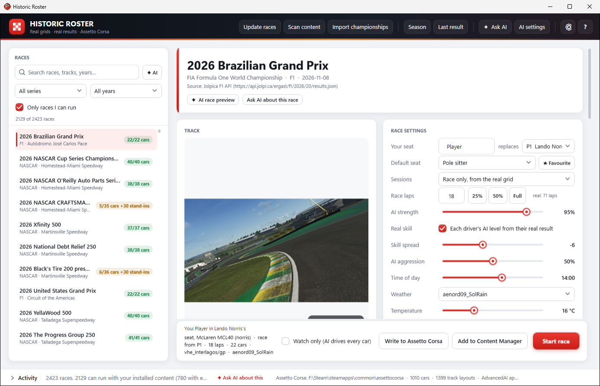
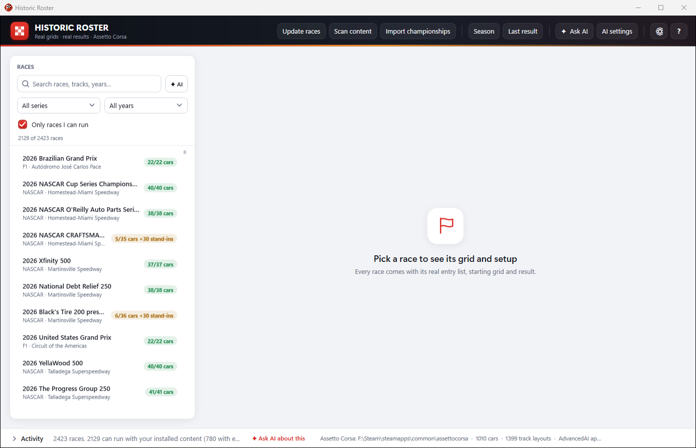

# Historic Roster: User Guide

Recreate real races in Assetto Corsa: F1, NASCAR, IMSA, WEC and Le Mans, IndyCar and CART, DTM,
Supercars and the classic endurance races.
Real grids, real cars, real tracks.

**Download:** get `HistoricRosterSetup.exe` from the
[latest release](https://github.com/Jcedwar61/HistoricRoster/releases/latest) (Windows, 64-bit).

**Start here: the Historic Roster program.** Run `HistoricRosterSetup.exe` to install it (no
administrator rights needed), open **Historic Roster** from the Start menu or desktop, pick a real
race, check the whole setup, and press **Start race**. See
[The Historic Roster program](#the-historic-roster-program) below. The rest of this guide covers
hosting online, the command line, and the details.





**Building it yourself:** install the .NET 8 SDK and [NSIS 3](https://nsis.sourceforge.io), put the race
database at `rosters/historic_rosters_db.json` (made with RosterTool), then run
`installer/build.ps1`. It writes `dist/HistoricRosterSetup.exe`.

Contents:

- The Historic Roster program
- AI help (OpenAI and DeepSeek)
- Live commentary with SimCast
- Working with AdvancedAI and Stretched Grid

1. What it does
2. The parts
3. Installing
4. Getting the race database
5. Matching your installed cars
6. The in-game app
7. Getting missing cars and tracks
8. Running a race online
9. Racing offline against AI
10. The content catalog
11. Adding your own races
12. Command reference
13. Good to know
14. Troubleshooting

---

## The Historic Roster program

A Windows program with its own window. It finds Assetto Corsa through Steam, so there's nothing
to set up. The .NET runtime is built in.

**Installing and uninstalling.** `HistoricRosterSetup.exe` installs the program for your Windows
user in `%LOCALAPPDATA%\Programs\Historic Roster`, with Start menu and desktop shortcuts. To remove
it, use **Settings > Apps > Installed apps > Historic Roster > Uninstall** (or *Uninstall Historic
Roster* in the Start menu). The uninstaller asks whether to keep your data (race database, track
choices, settings, seasons); keeping it means a reinstall picks up where you left off.

**Left: the races.** All real races, newest first. Search (`monza 2006`, `le mans`), filter by
series or year. **Only races I can run** (on by default) lists the races whose real track is
installed and that have real cars or stand-ins. Each race shows how many of its real cars you have
(green = all) and how many stand-ins fill the rest.

**Right: the setup before the race.**

- **Track:** the circuit's preview picture and outline, the AC track and layout, pit boxes, and
  whether it's installed. **Choose track...** picks the installed track yourself when the
  automatic match is wrong or finds nothing. The choice is remembered for every race at that
  circuit, in every series and year; **Use automatic match** undoes it.
- **Race settings:**
  - *Your seat:* any real driver on the grid. You start from that driver's real grid slot.
  - *Default seat:* the seat a race opens with: the pole sitter, a random midfield seat, your
    favourite team or your favourite driver. **★ Favourite** makes the current seat's driver and
    team your favourites.
  - *Sessions:* race only from the real grid, qualifying + race, or practice + qualifying + race.
  - *Race laps:* **25%**, **50%** or **Full** real distance (your choice is kept for the next
    races), or type any number.
  - *AI strength:* the level of the fastest AI driver (of each class, in a multi-class race). With *Real skill* on, every driver gets
    their own level from their real result (finishing position counts 60 %, starting position
    40 %). The best real driver gets the AI strength, the worst gets it minus the *Skill spread*.
    The grid shows each driver's level in the **AI** column.
  - *AI aggression*, *Time of day* (any hour, 00:00-23:45: night races are night),
    *Weather* (every weather installed, Sol included), and *Temperature*.
  - *Use the real race-day weather and start time* (on by default): looks up the weather at
    the real race (Open-Meteo's historical records, from 1940; needs the internet) and sets the
    real local start time, weather and temperature, the same whether you race or watch. The
    race is written with the real **date**, the circuit's **position and time zone** and the
    real **weather type** (rain included) for your weather controller (Pure, Sol or CSP's own),
    so the sun, the season, darkness and the sky match the real day. Start times come from the
    official sources (NASCAR's feed, the F1 calendar); for endurance and classic Wikipedia races
    it's the event's usual start (Le Mans 16:00, Coca-Cola 600 18:00 ...). If the lookup fails
    the note under the box turns red, so you know the race isn't using real conditions. Night
    starts (before 08:00 or after 18:00) need Custom Shaders Patch; without it you get a warning.
    Only the circuit's position (or town) and the race date are sent.
  - *Fill missing real cars with stand-ins:* a real car you don't have is replaced by an installed
    car of the same class (F1 for F1, GT1 for GT1), so the grid stays full. The stand-in is the
    car a team-mate drives in this race if you have it, else a car of the same make or team,
    from the closest year, with that driver's livery when the car has one. Team-mates share a
    stand-in. The real car stays in the missing list with its download link.
- **Starting grid:** every car with its livery picture, number, driver, team, the real car and its
  AC folder, the livery folder, the driver's real result and AI level. Your car is highlighted;
  stand-ins are marked. Real cars with no possible stand-in are listed at the bottom as left out.
- **Liveries:** when several drivers would show the same livery (the car has no livery with their number or name), a
  **Liveries** bar above the starting grid says how many. Its buttons:
  - **Find liveries online** opens a livery search for each of those cars. Livery packs you download are installed
    straight into the right car, whether the pack has the `content\cars\<car>\skins` folders or just bare livery folders.
  - **Generate liveries** makes one for each driver without one: a copy of an installed livery of that car, repainted
    in a colour of its own (black, white, grey and logos stay as they are), with the driver's name, number, team and
    nationality. The driver's race number from the race information is painted on the car's race-number textures
    (number panels, plates and decal sheets such as `numberplate.dds` or `RaceNumber.dds`), replacing the original
    livery's number there. A number painted into the main livery texture stays as it is, because where it sits differs
    for every car. The number also shows in Assetto Corsa's and CSP's name tags.
    Generated liveries are new folders starting with `hr_`; your own liveries are never changed.
  - **Remove generated** deletes those `hr_` folders again.
  A real livery for a driver (downloaded later) always wins over a generated one.
- **I have it…:** if a car you already installed is listed as missing (or a mod has no year or an odd name in its files), click **I have it…** next to it and pick it from all your installed cars. Your pick is used for that real car in every race of that series and season, with the livery that best matches each driver. To change or undo it later, right-click the car on the starting grid. The program also rechecks your cars whenever you switch back to its window, so cars you install while it's open are found without restarting.
- **Missing on this PC:** what the race needs that you don't have, with **Open** (download
  page) per item and **Get all missing**. Cars with a stand-in are listed here too. Direct links
  are downloaded and installed. overtake.gg pages open in your browser; when you download there,
  the program installs the archive from your Downloads folder by itself.

**Bottom right:**

- **Write to Assetto Corsa** puts the race into `Documents\Assetto Corsa\cfg\race.ini`. Your
  previous file is backed up first, and your driver name and Content Manager's own settings are
  kept.
- **Add to Content Manager** saves the race as a Content Manager Quick Drive preset, so you can
  start it from Content Manager instead. In Content Manager, go to **Drive > Quick Drive**, open
  the presets menu and pick **Historic Roster > (race name)**. The grid is also saved on its own
  under the Race Grids presets. Restart Content Manager if it was open. Content Manager's Quick
  Drive race has no practice or qualifying, so only the race is saved.
- **Start race** (or **Watch race**) writes it and starts it **through Content Manager**, which
  starts Assetto Corsa its usual way. CM is handed this exact race file, so the real grid,
  names, sessions and the watch-only flag are kept as written. Without Content Manager, the
  program starts `acs.exe` directly (Steam must be running then).
- Starting a race from Content Manager afterwards replaces this race with Content Manager's.

**Top bar:**

- **Season** drives a whole real season in one driver's seat. Pick the season, your seat and the
  round to join: earlier rounds count with their real results. **Set up next round** opens the
  next race in your seat. When it's done, your finishing order replaces the real one in the
  standings (the AI drivers keep their real names, so your race scores everyone). Points follow
  the season's own era (for example 10-8-6-5-4-3-2-1 in F1 from 2003 to 2009); sprint, stage and
  fastest-lap points aren't counted. **Abandon season** deletes it.
- **Last result** shows your last race next to the real result.
- **Update race database** downloads newly run races (and, for F1, the real start time and
  circuit position used by the real weather).
- **Scan my cars** matches cars you've installed since the last scan.
- **Import championships** reads Content Manager `.champ` files for exact liveries and
  period tracks.
- **Guide** opens this file.
- **Settings** lets you choose a different Assetto Corsa folder.

**After the race.** When you come back from Assetto Corsa, the program reads AC's result
(`Documents\Assetto Corsa\out\race_out.json`) and shows your race next to the real one: your
finishing position against your driver's real result, and every driver's places gained or
lost. This works for races started here and from Content Manager presets made here.

The **Activity** bar at the bottom shows progress and a log. Problems are written to
`%APPDATA%\HistoricRoster\error.log`.

## AI help (OpenAI and DeepSeek)

Optional. Add an API key in **AI settings** (top bar): an OpenAI key, a DeepSeek key, or both. Pick the
model (**List models** shows what your account offers, **Test** checks the key) and which service to use
first; with *If it fails or has no key, use the other service* on, a failed request goes to the other one.
Keys are stored encrypted for your Windows user in `settings.json`; the `OPENAI_API_KEY` and
`DEEPSEEK_API_KEY` environment variables work too. Any OpenAI-compatible address can be set under *Address*.

What the AI does:

- **Ask AI** (top bar, and **Ask AI about this race** under the race title): a chat that knows this guide
  and the race on screen (grid, matched track, missing content, setup). Ask how to do something, why a car
  is missing, or about the race's history.
- **Ask AI about this** (Activity bar): explains the activity log and `error.log` and what to do.
- **AI race preview** (under the race title): a briefing on the season, circuit, storylines and your
  seat's driver, with the real outcome at the end marked as a spoiler.
- **AI race report** (in the result window after a race): a report of your race against the real one.
- **Ask AI** next to the search box (or Ctrl+Enter): search in plain words ("Häkkinen's title deciders",
  "Le Mans in the Audi years"). The AI turns it into series, years and words; **Clear** undoes it.
- **Find mine with AI** (missing list): checks whether one of your installed cars or tracks is a missing
  real one (mods with odd names). Nothing is used until you confirm; undo as with **I have it…**.
- **Find online with AI** (missing list): finds the best mods for each missing car and track. OpenAI
  searches the web and DeepSeek answers from what it knows, both at once. The answers are merged, every
  link is checked, and a mod with no working link gets a search for its name. Options are ranked by quality,
  free before paid, found by both, and found on the web. Options only an AI remembers are marked
  *unconfirmed*. **Get** downloads and installs a direct link, or opens the page and installs the archive you
  download from your Downloads folder.
- **Suggest with AI** in the **I have it…** and **Choose track...** windows: selects the AI's pick for you
  to check.
- **Generate liveries** paints each driver's livery in their team's real colour (asked from the AI) when
  *Generated liveries use each team's real colour* is on.
- **Update database** also fills in the real F1 chassis (e.g. *Ferrari 312T3*, *Lotus 79*, *McLaren MP4/4*)
  where the results source only gives the team and year. OpenAI and DeepSeek are asked separately; a name
  is written only when both give the same car, or when one confirms the other's (OpenAI checks on the web).
  Entries the two disagree on keep the team name. Answers are kept in `rosters\_ai_f1_chassis.json`, so a
  season is only asked once. On the command line: `RosterTool ai update-db`, or `build-db --no-ai` to skip it.

Only the data the feature needs is sent (the race and grid, names of your installed cars or tracks, your
question), and only when you use a feature. AI can get facts wrong.

## Live commentary with SimCast

[SimCast](https://github.com/Jcedwar61/SimCast) is a free app that puts a TV commentary booth in your headphones.
When it's installed, Historic Roster tells it about the real race behind each race you start. The booth then names
the event and date, talks about the real grid, the real pole and the race-day weather, and says whose seat you took.
Once your race is over, it compares the result with what really happened. Two options appear under the race
settings when SimCast is installed:

- **Give SimCast's commentary the real race** (on by default) writes `%APPDATA%\SimCast\race_context.json` with each
  race, also when you save Content Manager presets. SimCast only uses it for Assetto Corsa, on the same track, within
  12 hours. With the setting off, the last race's file is removed, so SimCast never talks about an older race.
- **Start SimCast with the race** opens SimCast when you press **Start race**, unless it's open already.

SimCast holds the real result back until your race is over by default (*Settings → Commentary → Real result* in
SimCast). For the whole field it needs the CrewChiefEx app in Assetto Corsa, which SimCast switches on itself.

## Working with AdvancedAI and Stretched Grid

Both are offline CSP apps, and the race the program writes is made to work with them:

- **AdvancedAI** reads each session's type from `race.ini` to pick its preset and take over the
  AI; the program writes proper Practice / Qualifying / Race sessions. For races, AdvancedAI wants
  its Safety Car model on the grid (default `ferrari_458_s3`; the program reads your AdvancedAI
  setting). **Add AdvancedAI Safety Car** (off by default, because AI behaviour around it can be
  unreliable) puts it at the back of the grid, using a livery with
  "safety" in its name when the car has one. It's optional: untick it for a race without a Safety
  Car (AdvancedAI then uses a VSC or FCY). The choice is saved as soon as you change it.
  **The Safety Car never races.** With AdvancedAI switched on, AdvancedAI keeps it in its pit box
  and only sends it out to neutralise the race; the Historic Roster in-game app leaves it alone.
  With AdvancedAI switched off in its own settings, the in-game app parks it in its pit box for the
  whole session, and Assetto Corsa says *Safety Car kept in its pit box*. The app tells the two
  apart from AdvancedAI's journal (`Documents\Assetto Corsa\logs\AdvancedIA.log`). If that
  journal is switched off, the app parks the Safety Car only once it has raced for 10 seconds
  without having been in the pits (in practice and qualifying, 3 seconds on track).
- **Stretched Grid** reads the first session's type and, for a race, `STARTING_POSITION` from
  `race.ini`. The program writes your driver's real grid slot there, so Stretched Grid places you
  correctly. With qualifying first, your slot comes from qualifying.
- Neither app is touched or configured by the program. Both only work offline, so the server
  plugin and the in-game app (online) don't interfere with them.
- The grid is limited to the track's pit boxes (Assetto Corsa's own limit). The Safety Car is added on top of the real grid and never takes a real car's place: if every pit box is used by a real car, or a real car uses the Safety Car model, no Safety Car is added and the program says so (AdvancedAI then uses a VSC/FCY).

---

## 1. What it does

Pick a real race, such as the 2009 British Grand Prix, the 2004 24 Hours of Le Mans or the
2004 Daytona 500. Historic Roster then:

- builds the real grid: drivers, numbers, teams, cars and starting order;
- uses **the real cars and the real track**. If a real car or track isn't installed, it is
  listed as missing with a download link. A missing car can get a marked stand-in of the same
  class so the grid stays full (offline: a tick box; online: `StandIns: SameClass`); the track
  is never swapped;
- recreates the race day: the real start time, date, weather (rain included) and temperature,
  and the real race distance (or a share of it);
- picks the right livery of each car when it is installed, by matching the race number,
  driver or team in the car's skins;
- sets up an online server (AssettoServer), or an offline race with every other real driver as AI.

## 2. The parts

| Part | Where it runs | What it's for |
|---|---|---|
| **Historic Roster program** | Your PC (window) | Pick a race, see and adjust the full setup, get missing content, write it into Assetto Corsa and start it |
| **HistoricRosterPlugin** | Your AssettoServer | Loads a race onto the server (cars, liveries, names, track), saves races you run, powers the in-game app |
| **RosterTool** | Your PC (command line) | Builds the race database, scans your installed cars, installs missing content, writes offline races, installs the app |
| **Historic Roster app** | In game (CSP apps sidebar) | Browse and search races, see the grid, get missing content, and, as server admin, load races |

## 3. Installing

### RosterTool and the in-game app

RosterTool needs the .NET 8 runtime (already on most Windows PCs). Open a terminal in the
RosterTool folder and run:

```
RosterTool find
RosterTool install-app
```

`find` shows where Assetto Corsa is. It reads Steam's library list, so it finds AC on any drive.
`install-app` copies the app, this guide and RosterTool into
`assettocorsa\apps\lua\HistoricRoster`.

In game, open the **apps sidebar on the right edge of the screen** and click
**Historic Roster**. It needs Custom Shaders Patch (CSP): any build that runs Lua apps, release or
preview. On an older build, anything that build can't do is switched off and the rest still works.
For example, the director camera needs a build with scripted cameras; without one, Assetto Corsa's
own cameras are used.

### The server plugin (for hosting)

1. Copy the built `HistoricRosterPlugin` folder into your AssettoServer `plugins` folder.
2. In `cfg\extra_cfg.yml` add:
   ```yaml
   EnablePlugins:
   - HistoricRosterPlugin
   ```
3. Start the server once. It creates `cfg\plugin_historic_roster_cfg.yml` and a `rosters`
   folder containing the content catalog.
4. Put `historic_rosters_db.json` (next section) into that `rosters` folder.

## 4. Getting the race database

RosterTool downloads real results into one file, `historic_rosters_db.json`:

```
RosterTool build-db --server "D:\AssettoServer"
```

| Series | Source | Years |
|---|---|---|
| F1, every race | Jolpica F1 API | 1996 to today |
| NASCAR Cup, every race | NASCAR's results feed | 2017 to today (add `--nascar-series 1,2,3` for Xfinity and Trucks) |
| NASCAR crown jewels | Wikipedia race articles | 1996 to 2016: Daytona 500, Coca-Cola 600, Brickyard 400, Southern 500 |
| IMSA WeatherTech SportsCar Championship, every race, all classes | IMSA's official timing archive | 2016 to today: official results; the grid is the qualifying order class by class |
| IMSA Michelin Pilot Challenge (GS / TCR) | IMSA's official timing archive | 2016 to today |
| IMSA before 2016: ALMS, United SportsCar, IMSA GT | Wikipedia race articles | the rounds that have an article (mostly ALMS 1999 to 2013) |
| FIA World Endurance Championship | Wikipedia race articles | 2012 to today, every round with an article |
| IndyCar (IRL) and CART / Champ Car | Wikipedia race articles | IndyCar 1996 to today, CART 1979 to 2007, with the Indianapolis 500 |
| DTM | Wikipedia race articles | the rounds that have an article (2000 to today); both races of a weekend |
| Supercars | Wikipedia race articles | the events whose article has the results (mostly the endurance races) |
| Endurance: Le Mans, Sebring, Daytona 24, Petit Le Mans, Spa 24, Bathurst 12 Hour, Nürburgring 24 | Wikipedia race articles | Le Mans from 1923, Sebring from 1952, Daytona from 1966 (from 2016 Daytona, Sebring and Petit Le Mans come from IMSA's archive) |

Useful options: `--from 2004 --to 2009` for a few seasons, `--series f1` for one series (keys:
`f1`, `nascar`, `nascar-classic`, `endurance`, `imsa`, `wec`, `imsa-classic`, `indycar`, `cart`,
`dtm`, `supercars`), and `--refresh` to download again. A full build takes an hour or more the
first time because it waits politely between requests. Running it again only fetches what's new.

Multi-class races (IMSA, WEC, Le Mans) keep every car's real class (GTP, DPi, LMP2, GTLM, GTD ...),
and stand-ins are picked by class: a GTD car gets a GT3 stand-in, a DPi a prototype. In the
program's series list, IMSA and WEC races are also under **IMSA** and **WEC**.

Without `--server`, the file goes in RosterTool's own `rosters` folder.

## 5. Matching your installed cars and tracks

Your cars **and** tracks are always matched to the real ones. The program does it by itself when
it starts and whenever your `content\cars` or `content\tracks` folder changes (a mod added or
removed); **Scan my cars and tracks** or `RosterTool scan` does it on demand.

Cars:

- **F1:** team and season, from the name, folder or chassis code. For example
  `gp_2009_bgp_001` is the 2009 Brawn, `Grand Prix 1998 SF2` the 1998 Stewart and
  `Cooper T53` a 1960 Cooper. Season packs named "Grand Prix 1998" count as F1.
- **NASCAR:** make (also from the model: Camry is a Toyota) and the car generation, so a 2025
  car runs the 2022-on Next Gen races, using the nearest model year you have. Mods with
  road-course, superspeedway and short-track versions (`_rc`, `_ss`, `_st`) get the right one for
  each track. ARCA cars aren't used for Cup races.
- **GT, prototypes and Supercars:** the distinctive words of the model name, also inside packs
  (`ACF HY - Ferrari 499P 2023` is the 499P, `ATCC V8 Supercars 2003 - Ford BA` the Ford BA).
  A car without "Evo" in its name isn't used for the later Evo version.

Tracks: every real circuit in the race database is matched to an installed track by its name,
town and folder (and the F1 data's own circuit id, so `acu_interlagos` is Autódromo José Carlos
Pace). Ovals never stand in for road circuits or the other way round. The layout suits the
races held there: the oval for NASCAR, the Roval or road course for road-course races, the GP
layout for F1 and the endurance layout for sports cars. Hand-made catalog rules (section 10)
come first when their track is installed.

It writes:

- `content_catalog.installed.json`: these matches;
- rosters made from your own cars and liveries (`installed-gt3`, `installed-f1`, ...);
- a list of the real events you can recreate most completely (`_library_report.txt`).

> Cars whose files have no year or recognisable model name are skipped rather than guessed.
> Add them to the catalog by hand (section 10).

### Importing Content Manager championships

Season packs often include a Content Manager championship (a `.champ` file) that says exactly which
car and livery each driver uses, and which track the pack author picked for each round. Import
them with:

```
RosterTool champ
```

This reads every `.champ` in `Documents\Assetto Corsa\champs`. You can also point it at a downloaded
pack: `RosterTool champ "D:\Downloads\F1 2006 pack"`. It writes `content_catalog.champs.json` with:

- **one rule per seat:** that driver, in that season, drives that exact car folder with that livery.
  these rules come first, so they beat the general rules from `scan`;
- **one rule per round** that matches a real race of that season: the pack's track and layout for
  that circuit and year.

rounds are skipped when the layout is from a later era than the season (for example a 2023
barcelona layout in a 2006 championship), or when there was no race at that circuit that year.
the report lists each skipped round and any driver it couldn't find in the real results. run
`champ` again after adding championships.

## 6. the in-game app

| Tab | What it does |
|---|---|
| **Races** | Search ("le mans 2008", "monaco") and filter by series. Click a race to select it. |
| **Grid** | The real grid. A car name in green is installed on your PC; red means it is missing. Hover for the AC car folder and livery. |
| **Classes** | Only in multi-class races you drive or watch offline: every class in its running order, with each car's overall place and laps down. |
| **Get content** | What this race needs that your PC doesn't have, with an **Open** button per item and **Download and install all missing**. |
| **Admin** | Load a race on the server, undo, status, and import F1/NASCAR races. Only server admins can do these: log in first with `/admin <password>` in chat. |
| **Settings** | Server address and RosterTool path overrides, your content folders, the on-screen class position for multi-class races, and a button that opens this guide. |

The app works while you're connected to a server that runs the plugin. Server replies and
RosterTool progress show in the log at the bottom.

## 7. Getting missing cars and tracks

From the app, click **Download and install all missing**. From the command line:

```
RosterTool install f1-2004-05-spanish-grand-prix
```

- **Direct download links** are downloaded and installed automatically.
- **overtake.gg pages** open in your browser. overtake.gg needs you to be logged in and has a
  bot check, so you click Download yourself. RosterTool watches your `Downloads` folder for
  30 minutes (`--watch`) and **installs each archive as soon as it finishes downloading**.
- **Official Kunos cars and tracks** come with the base game or DLC on Steam, and are only listed.

Archives are installed like Content Manager does it: every car folder goes to `content\cars`
and every track to `content\tracks`.

- `.zip` works out of the box; `.7z` and `.rar` need [7-Zip](https://www.7-zip.org).
- Existing folders are kept unless you add `--overwrite`.
- To also install onto a server on the same PC, add `--server-content "D:\AssettoServer\content"`.
- Install any archive by hand with `RosterTool install-archive file.7z`.

> Download links come from the catalog where an exact mod page is known, otherwise from an
> overtake.gg search for that car or track. **Other sites** (in the program) and the extra buttons
> in the in-game app search acmods.net and Google too; official content links to Steam's list of
> Assetto Corsa DLC. Server admins can change the sites with `ExtraDownloadSearchUrls`. Many historic mods are skin packs that need a base
> car; the catalog note says so. Some mods are paid (RSS, VRC).

## 8. Running a race online

1. Find the race: `/roster_find 2009 british`, or use the app.
2. Check what's missing on the server: `/roster_content f1-2009-08-british-grand-prix`.
3. Load it: `/roster_load f1-2009-08-british-grand-prix`. This:
   - writes `entry_list.ini` (real drivers, numbers, teams, liveries, grid order, booked seats);
   - switches `TRACK`, `CARS` and `MAX_CLIENTS` in `server_cfg.ini`;
   - sets the race to the real distance (`[RACE] LAPS`), or `RaceLengthPercent` of it;
   - sets the real race-day conditions: start time, date, weather and temperature, looked up
     in the Open-Meteo weather archive (`SUN_ANGLE` and a single `[WEATHER_0]`);
   - writes Content Manager download links, so players without a car get a download button
     when they join.
4. **Restart the server.** Assetto Corsa only reads the car list and track at startup.

Options, in any order: `/roster_load <id> 25% noweather standins FinishingOrder`.

| Option | What |
|---|---|
| `StartingGrid` / `FinishingOrder` / `AsListed` | Grid order (default `DefaultGridOrder`) |
| `25%` | Race length as a share of the real distance; `0%` leaves the server's length alone |
| `weather` / `noweather` | Use or skip the real start time and weather |
| `standins` / `nostandins` | Fill missing real cars with installed cars of the same class, or leave them out |

**Real conditions.** Rain, night starts (Abu Dhabi, Singapore, Le Mans) and the sun's path on the
real date need WeatherFX, which AssettoServer turns on by default (`EnableWeatherFx` in
`extra_cfg.yml`; players need CSP). Without it the plugin sets a dry Kunos weather and a sun
angle between 08:00 and 18:00, and tells you what it couldn't do. Wikipedia races take the race
day from the article and the event's usual start time. Lookups are cached in `rosters\_conditions.json`.

**The real grid.** AssettoServer normally sets a race's grid from the best laps of the session
before it (practice, qualifying, or the previous race when sessions loop). With
`KeepRealGrid: true` (the default), every race of a roster loaded with `StartingGrid` starts
from the real grid anyway, so you can keep practice and qualifying for fun. Turn it off to let
qualifying set the grid.

Loading is refused if the real track isn't installed on the server. Cars that aren't
installed are left out and listed, with links, until you install them, unless stand-ins are on.
`/roster_restore` puts the previous files back.

**Picking your driver.** Players book a real driver's seat with `/roster_seat senna` or
`/roster_seat #12`. The slot is reserved for their Steam account in `entry_list.ini` from the
next restart, and the booking is kept for the next time that race is loaded. `/roster_unseat`
frees it, `/roster_seats` lists the bookings. A booked seat stays empty if its player doesn't
join. Turn booking off with `AllowSeatBooking: false`.

When players join, each is told whose seat they took and the real result ("2009 British Grand
Prix: you are driving Jenson Button's #22 Brawn 2009 ... Real race: started P6, finished P6").
After the race each is told how they did against history ("You finished P3 as Button - real
result P6, +3: you beat history!"), and everyone hears the biggest gain.

With `CaptureRaceResults: true`, every race you finish on the server is saved as a roster in
`rosters\captured\` (category `Captured`), listed after the real races.

## 9. Racing offline against AI

```
RosterTool race f1-2009-08-british-grand-prix --as Button --launch
```

This writes `Documents\Assetto Corsa\cfg\race.ini` with the real grid. **You replace a real
driver**: pick them with `--as <name>` or by grid position with `--grid 5` (default: pole
sitter). You start from their grid slot in their car and livery, under your own name
(`--name "Your Name"`; default: the name already in `race.ini`, which is backed up first). Every
other real driver is AI in their own car and livery.

The race gets the real start time (night included), date, sun, time zone and weather, with or
without `--watch`. `--time 20:30` sets another local start; `--no-real-conditions` skips the
weather lookup. When SimCast is installed, the race's details go to its commentary as well
(`%APPDATA%\SimCast\race_context.json`); `--no-simcast` leaves them out and removes the last race's.

In the Historic Roster program it's the **Your seat** row: type your name, then pick the grid
position whose driver you replace. The grid, the race, your results ("Jim (as Button)") and season
standings show your name; the comparison with the real result still uses the driver you replaced.
Content Manager presets (`--cm`) use Content Manager's own driver name.

Online, a seat booked with `/roster_seat` is listed under the player's own name in the server's
entry list.

**Watching an AI race.** Tick **Watch only (AI drives every car)** next to the Start button (or
`RosterTool race <id> --watch`). Every car is driven by the AI, the seat you picked included,
and **every driver keeps their real name**; your name isn't used. The camera starts on the seat
you picked, on the TV cameras. It needs Custom Shaders Patch: the Historic Roster in-game app
(installed or updated automatically by the program) switches on CSP's autopilot for that car
when the race loads. Open the app from the apps sidebar for its **Watch** tab:

- follow the **whole grid** (the default), the leader, the closest battle, or a car you pick from
  the running order. **Next car** cuts to another car straight away (even in the middle of a
  battle or a qualifying lap). In whole-grid and battle mode,
  **a battle on track always comes first**: as soon as a car is within about 30 m of the car ahead,
  the camera goes there and frames both cars, and stays while the fight lasts (until the gap grows
  past about 55 m). A train of cars nose to tail counts as one battle, filmed at its front. With no
  battle anywhere, it rotates through the field, giving screen time to whoever has gone longest
  without it. **The Safety Car is never filmed**;
- a caption in the bottom-left corner shows who is on screen (position, number, driver, car), and
  which position a battle is for and against whom;
- the **director camera** films whichever car you follow: trackside TV shots that zoom as the
  car approaches and cut to the next camera as it passes, mixed with chase and helicopter shots
  (or pick one kind). Every trackside camera is placed where it has a clear view of the track and
  of the stretch the car comes from (on ovals: on the infield, above the walls). The camera keeps the
  car (and in a battle, both cars) in the picture: it aims a little ahead of the car, never zooms in
  so far that a fast car can slip out, and widens the view quickly if a car nears the edge. Every camera
  move and zoom starts and stops smoothly, and the camera follows the car without lagging behind it, so
  the picture doesn't jerk. A change of car on the same trackside camera is a smooth pan; otherwise
  it's a clean cut. Before a car passes so close that following it would need a whip pan, the director
  cuts to the next camera. It also cuts to a new shot within a fraction of a second when something
  hides the car or it can't be kept in frame,
  and within a second when the car pits, retires or stops. Assetto Corsa's
  own TV cameras can only follow your seat's car during a
  live race, which is why the app brings its own. It only ever runs in a watch-only race;
  untick it to get AC's cameras back;
- **every session is filmed the way TV films it.** A watched weekend can be the race only,
  qualifying and the race, or practice, qualifying and the race:
  - **practice and qualifying** have no battles, so the director follows the cars on **flying
    laps**: a qualifying lap is followed all the way to the line and its time and place shown
    before the next car gets its turn; practice rotates through the cars out on track. Cars higher
    up the times, cars currently up on their best lap and cars not seen for a while come first, with
    more onboard laps than in the race. When nobody is out on track, the camera goes to a car
    leaving the pits (pit lane cameras), else stays with a car in its pit box. **Leader** follows
    the fastest car while it is out on track; **Closest battle** works like whole grid here;
  - **the race** starts on your seat, with wide shots of the grid and the field getting away. On
    the **last lap** the camera stays with the leader and films it **crossing the line** from the
    cameras at the finish, holds on the winner, then shows the next cars taking the chequered flag,
    class winners and close finishes first. Cars on their cool-down lap are never treated as a
    battle;
  - the caption adds where the session is (*Race · Lap 12 / 50*, *Final lap*, *Qualifying ·
    8:31 left*, *Chequered flag*) and what the car is doing: *Flying lap 0:45.2 −0.21* (green when
    it's up on its best lap), *Lap 1:32.456 personal best P3*, *Out lap*, *In the pits*, *Wins the
    race*, *Finishes GT1 P2*. In practice and qualifying the Watch tab's running order shows each
    car's best lap;
- the ideal racing line is switched off automatically while you watch, and back to how you had
  it if you take over the car;
- **Drive yourself** takes over the car (AC's own autopilot key, C, does the same), and **Let AI
  drive** hands it back.

**A watched race finishes as it did in real life.** The in-game app steers every car to its real
finishing position: it nudges each car's pace (AI level and grip) toward its real place among the
cars still running, gently at first and firmly in the last quarter of the race. Then cars still
out of place lose their collisions so they can get past cleanly, and cars too far forward are held
back. Cars that really retired go into the pits at the same point of the race (scaled to your
race length) and park there, and AC's own random AI retirements are switched off. The Watch tab
shows how many cars are still out of their real place, and **Finish as in real life** turns it
off. Keep AdvancedAI switched on (in its own window): it drives the AI cars in place of Kunos's
stock AI, and the real result is steered on top of it. The Watch tab says when AdvancedAI is
switched off and the stock AI is driving.

**Multi-class races.** Endurance races with several classes on one grid (LMP1, LMP2, GTE Pro, GT3,
prototypes ...) are handled class by class:

- the starting grid gets a **Class** column, and the real result shows the class position too
  ("P18 · class P6"); the grid title says how many classes there are;
- with *Real skill* on, AI levels are ranked **within each class**: the best driver of every class
  gets the AI strength and its slowest gets it minus the *Skill spread*. (A GT class winner who
  finished 18th overall is still a top GT driver; the car's speed already makes the class slower.)
  Turn on *Fill missing real cars with stand-ins* to keep every class full: a stand-in always comes
  from the same class;
- the result comparison shows your place in your class next to the overall one, and the **+/-**
  counts within the class ("You finished LMGTE Pro P2 (P14 overall)");
- in game, the Historic Roster app adds a **Classes** tab (every class in its running order, with
  each car's overall place and laps down) and shows your class position at the top of the screen
  while you drive (*Settings > Multi-class races: show my class position on screen* turns it off).
  In a watched race the camera only treats cars of the same class as a battle (a prototype lapping
  a GT car isn't one), and the caption shows the class position ("Battle for GT1 P3").

A watched race still gets a result comparison with the real race afterwards, but no driver is
marked as you and it never counts for a season. Content Manager presets can't carry the watch
flag, so use **Watch race** or **Write to Assetto Corsa**.

Options: `--laps 20`, `--ai-level 90`, and `--launch` to start the race through Content Manager
(or `acs.exe` directly when CM isn't installed). Starting a *different* race from Content
Manager overwrites `race.ini`. Or add `--cm` to also save the race as a Content Manager Quick
Drive preset (under **Historic Roster**). Quick Drive uses CM's own driver name and can't watch.

## 10. The content catalog

`rosters\content_catalog.json` says which AC folder *is* each real car and circuit. Comments
with `//` are allowed and changes apply immediately.

Car rule:

```json
{ "category": "F1", "yearFrom": 2008, "yearTo": 2008, "team": "McLaren",
  "model": "my_mclaren_mp4_23", "skin": "hamilton_22",
  "url": "https://www.overtake.gg/downloads/..." }
```

Names are compared ignoring case and accents ("Huracan" matches "Huracán"). Add `"exclude"` to
keep later versions of a car off an older AC car:
`{ "car": "911 GT3 R", "yearFrom": 2016, "yearTo": 2018, "exclude": ["992", "991.II"], "model": "..." }`.

Every official Kunos race car (base game and all DLC) is already in the catalog with the seasons
it raced, because Kunos's own car files carry no year for `scan` to read. When several rules
match, the first one naming a car or track **you have installed** wins. Your championship imports
come first, then the main catalog, then the automatic scan.

Track rule (`match` words are compared with the circuit name; add `yearFrom`/`yearTo` for a
period layout):

```json
{ "match": ["silverstone"], "yearFrom": 1996, "yearTo": 2009,
  "folder": "my_silverstone_2009", "layout": "gp" }
```

Balance rule, for multi-class grids on the server (ballast in kg, restrictor in %). The first
match is used, only for entries that don't set their own `ballast`/`restrictor`. Match by
`category`, `class` (substring of the entry's class), `car`, `model` (AC folder) and years:

```json
"balance": [
  { "category": "LMP1", "class": "GT", "ballast": 30, "restrictor": 10, "note": "GT cars at Le Mans" }
]
```

Only map a folder that really is that car or circuit. Rules are checked top to bottom, so put
specific ones first. `content_catalog.installed.json` is rewritten by `scan`; put your own
rules in the main catalog.

## 11. Adding your own races

Save a file such as `rosters\1998-fia-gt-silverstone.json`. The file name is the race id.

```json
{
  "name": "1998 FIA GT Championship - Silverstone",
  "category": "GT1", "series": "FIA GT Championship", "year": 1998,
  "track": { "name": "Silverstone" },
  "source": "where the data came from",
  "entries": [
    { "driver": "Driver A / Driver B", "team": "Team", "number": "1", "class": "GT1",
      "car": "Mercedes CLK-LM", "gridPosition": 1, "position": 1,
      "model": "optional AC folder", "skin": "optional", "downloadUrl": "optional exact page" }
  ]
}
```

A file with the same id as a database entry wins, so you can correct a race by saving your own
copy.

For F1 and NASCAR, admins can also import single races in game: `/roster_f1 2004 5` or
`/roster_nascar 2019 1 9`. Without the last number, they list the season.

## 12. Command reference

### Server chat commands

| Command | Who | What |
|---|---|---|
| `/roster_find <words>` | everyone | Search races |
| `/roster_list [series]` | everyone | List races |
| `/roster_info <id>` | everyone | Grid and result |
| `/roster_content <id>` | everyone | Real cars/track missing on the server, with links |
| `/roster_active` | everyone | Running race (laps, real conditions) / race waiting for restart |
| `/roster_seat [driver or #number]` | everyone | Book a real driver's seat in the loaded race, or show yours |
| `/roster_unseat` | everyone | Free your booked seat |
| `/roster_seats` | everyone | Booked seats of the loaded race |
| `/roster_load <id> [options]` | admin | Load the race (restart to apply); options in section 8 |
| `/roster_restore` | admin | Undo the last load |
| `/roster_f1 <year> [round]` | admin | List or import an F1 race |
| `/roster_nascar <year> <series> [n]` | admin | List or import a NASCAR race (2017+) |

### RosterTool

| Command | What |
|---|---|
| `find` | Show your AC install and what's in it |
| `build-db` | Download real grids into the database (then the AI step; `--no-ai` skips it) |
| `ai update-db` | Only the AI step: real F1 chassis names, checked by OpenAI and DeepSeek |
| `scan` | Match your installed cars to real cars; rosters from your liveries |
| `champ [file or folder]` | Import Content Manager championships: exact car, livery and track per driver and season |
| `install <id>` | Get the missing real cars/track for a race |
| `install-archive <file>` | Install a downloaded car/track archive |
| `race <id>` | Offline race against AI |
| `install-app` | Install the in-game app, this guide and RosterTool |
| `wiki <article title>` | Check how a Wikipedia race article is read |
| `wiki-season <series> <year>` | The race articles of a season (`wec`, `imsa-classic`, `indycar`, `cart`, `dtm`, `supercars`); `--import 5` reads the first five |
| `imsa <year>` | The IMSA races in IMSA's timing archive (`--mpc` for Michelin Pilot Challenge, `--import 3` reads the first three) |

Common options: `--content "<assettocorsa>\content"` (normally found automatically),
`--server "<AssettoServer folder>"` or `--rosters "<folder>"`.

## 13. Good to know

- **Nothing is substituted unless you ask.** A race uses the real cars and the real track.
  Stand-ins are opt-in and always marked; the track is never swapped. The more mods you
  install, the more complete the grid.
- **Tracks are matched by circuit.** Many circuits changed layout over the years, so map a
  period-correct track mod with a year range in the catalog when you have one.
- **Online slots are for players.** AC servers have no AI racing opponents; use `race` for AI.
- **Data coverage:**
  - F1 is complete from 1950 (the database update downloads every season).
  - Supercars: the Bathurst 1000 from 1996 and the other events whose Wikipedia article has the
    results.
  - NASCAR is complete from 2017, with crown jewels before that.
  - IMSA is complete from 2016 (official results). IMSA's starting grids are published only as
    PDFs, so the grid is the qualifying order, class by class.
  - WEC, IndyCar, CART, DTM and the older IMSA series come from the races' Wikipedia articles:
    a race without an article, or whose article has no results table, isn't in the database.
    BTCC, Super GT and Grand-Am have no race articles to read.
  - Endurance races come from Wikipedia and depend on each article. A few years are missing or
    are entry lists only, and those are marked in the race notes.
- **NASCAR's feed is unofficial** and could change. You can switch it off in the plugin config
  (`EnableNascarImport`).
- **Downloads stay under your control.** The tools never log in anywhere or get past a site's
  bot check; pages that need you open in your browser.

## 14. Troubleshooting

| Problem | What to do |
|---|---|
| The app says "Not connected" | Join a server running the plugin, or set the server address (`http://ip:http_port`) in Settings. |
| The app says "HTTP 404" | The server doesn't run HistoricRosterPlugin. Check `EnablePlugins` in `extra_cfg.yml`. |
| Admin buttons do nothing | Log in as admin in chat (`/admin <password>`). Replies appear in the app log. |
| "RosterTool not found" in the app | Run `RosterTool install-app` again, or set the path in Settings. |
| "Needs 7-Zip" | Install 7-Zip, or drag the archive onto Content Manager. |
| Server won't start after a load | Run `/roster_restore` (or copy back the newest `.bak` files in `cfg`) and check the server log. |
| A car I have is "missing" | Run `RosterTool scan`. If it still isn't matched, add a catalog rule for it. |
| Wrong livery | Set `"skin"` on the entry in a roster file, or on the car's catalog rule. |

---

## Building from source

| Folder | What | Build |
|---|---|---|
| `App/` | The Historic Roster program (WPF, .NET 8) | `dotnet publish App -c Release -r win-x64 --self-contained true -p:PublishSingleFile=true -o dist/HistoricRoster`, then copy `rosters/historic_rosters_db.json` next to it |
| `Core/` | Logic shared by the program and RosterTool: race.ini writer, downloads, database builder, scanner, championship import | (referenced by both) |
| `HistoricRosterPlugin/` | AssettoServer plugin (C#, .NET 11) | Link it into AssettoServer's `Plugins/` folder (on this PC, `D:\AI\AssettoServer\Plugins\HistoricRosterPlugin` is a junction to it), then `dotnet publish Plugins/HistoricRosterPlugin -c Release`. Output: `out-win-x64/plugins/HistoricRosterPlugin/` |
| `HistoricRosterPlugin/Shared/` | Code shared by the plugin and RosterTool: importers, catalog, resolver, content scanner | (compiled into both) |
| `RosterTool/` | Standalone tool (C#, .NET 8) | `dotnet publish RosterTool -c Release -r win-x64 --self-contained false` |
| `CspApp/HistoricRoster/` | CSP Lua app and this guide | Copied by `RosterTool install-app` (RosterTool's build output includes it) |

The plugin needs AssettoServer's source to build against
(<https://github.com/compujuckel/AssettoServer>), because its `Plugins/Directory.Build.props`
supplies the references.
